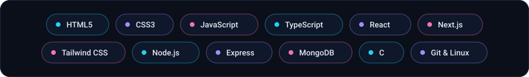

 

<h3>✦ &nbsp;S T A C K&nbsp; ✦</h3>

<h3>✦ &nbsp;S E L E C T E D &nbsp; W O R K&nbsp; ✦</h3>

<table>
<tr>
<td width="50%"></td>
<td width="50%"></td>
</tr>
<tr>
<td width="50%"></td>
<td width="50%"></td>
</tr>
</table>

<h3>✦ &nbsp;N U M B E R S&nbsp; ✦</h3>

