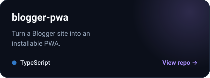

  

  
  
  

<h3>✦ &nbsp;S T A C K&nbsp; ✦</h3>

<h3>✦ &nbsp;S E L E C T E D &nbsp; W O R K&nbsp; ✦</h3>

  
  
  
  

<h3>✦ &nbsp;N U M B E R S&nbsp; ✦</h3>

  
  

  

<h3>✦ &nbsp;C O N N E C T&nbsp; ✦</h3>

  
  
  

 

