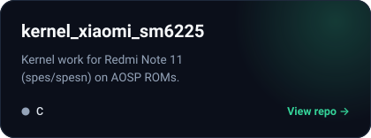

  <!-- HEADER -->
  

  

    <strong>Full Stack Developer</strong> · Building useful things for the web
  

  

    
    
    
  

---

## About

---

## Tech Stack

  

---

## Featured Projects

  

  

  

  

---

## GitHub Analytics

 

 

---

## Connect

&nbsp;

&nbsp;

  

